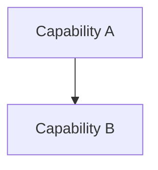

# Feature Map: <Project>

## Capability inventory

| ID | Capability | Outcome | Actors | Scope status | Evidence |
|---|---|---|---|---|---|

## Access matrix

## Dependencies

## Delivery slices and waves

| Wave | Slice | Demonstrable outcome | Dependencies | Parallel-safe |
|---|---|---|---|---|

## Risks and unresolved assumptions

