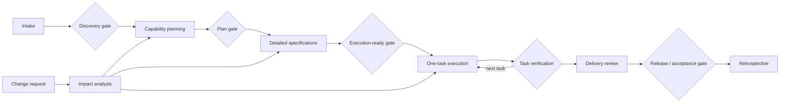

# AI-Assisted Software Delivery Workflow

This repository carries both an application template and an agent harness for taking work from uncertain requirements to verified delivery.

The harness is intentionally agent-neutral:

- `AGENTS.md` is the canonical repository instruction surface.
- `.agents/skills/` is the canonical skill source and Codex discovery path.
- `.claude/skills/` exposes the same skills to Claude Code through repository symlinks.
- `docs/specs/` contains project truth.
- `docs/tasks/` contains executable work state.
- `docs/client-comms/` contains approval and scope evidence.

The original source document that seeded this harness is preserved verbatim at
[`docs/ai-workflow/source-material/original-harness-seed.md`](source-material/original-harness-seed.md).
Treat it as evolving source material, not the normalized operating spec.

## Operating model

The unit of progress is not generated code. It is verified evidence that an agreed outcome works.

## Artifact authority

When artifacts conflict, use this order and stop to reconcile the conflict:

1. current human instruction;
2. approved change request;
3. locked discovery scope;
4. approved decision log entry;
5. approved detailed specification;
6. task file;
7. implementation and tests;
8. agent inference.

Implementation does not silently become the specification merely because it exists.

## Lifecycle

### 0. Bootstrap

Fill `docs/specs/_overview.md`. Record known facts, source material, repository state, stakeholders, and unresolved setup questions.

### 1. Discovery

Use `$workflow-intake`. The first pass interrogates missing context; it does not manufacture a polished specification from weak evidence.

Exit when the discovery gate passes and approval evidence is recorded.

### 2. Capability planning

Use `$feature-mapping` to define capability boundaries, access, dependencies, vertical slices, and waves.

Exit when the feature-map gate passes.

### 3. Detailed planning

For each epic or slice:

1. `$data-modeling` when persisted state or lifecycle matters.
2. `$epic-and-flow` for behavioral journeys.
3. `$api-spec` for contracts crossing component or system boundaries.
4. `$task-generation` after the specifications are approved.

These steps are dependency-driven, not dogmatically sequential. A flow can expose a data-model gap; an interface can expose a missing failure path. Reconcile and rerun the affected gate.

### 4. Execution

Use `$execute-task` for exactly one ready task. Each task loads its own context, implements a bounded outcome, and records verification evidence.

Branching and commit policy come from `AGENTS.md`. The harness does not assume every repository uses the same Git flow.

### 5. Change control

Use `$change-management` whenever approved scope, data, authorization, contracts, acceptance, schedule, or completed behavior may change.

Never erase the old baseline. Append the request, impact, approval, superseded decisions, and remediation tasks.

### 6. Delivery

Use `$delivery-review` to reconcile scope and implementation, assess operational readiness, prepare stakeholder acceptance, and capture reusable lessons.

## Epistemic rules

- Label facts, assumptions, inferences, decisions, and open questions distinctly.
- Attach evidence paths or URLs when practical.
- Give every material assumption an owner and validation deadline.
- Do not treat plausible defaults as client requirements.
- Stop on contradictions involving scope, authorization, persisted data, security, destructive behavior, or public contracts.
- Prefer a smaller confirmed scope over a larger imagined one.

## Human responsibilities

Agents can prepare and evaluate artifacts. Humans own:

- stakeholder approval and scope locking;
- acceptance of material assumptions or risks;
- financial, legal, and delivery commitments;
- production release authority;
- final acceptance.

## Start a project

1. Create a repository from this template.
2. Replace placeholders in `docs/specs/_overview.md`.
3. Put raw evidence in a durable location and reference it from the overview.
4. Invoke `$workflow-intake`.
5. Run `$review-gate` at each transition.
6. Keep `_context-block.md`, `_decisions.md`, and `_index.md current.

Run `pnpm harness:validate` after changing skills or workflow artifacts.
